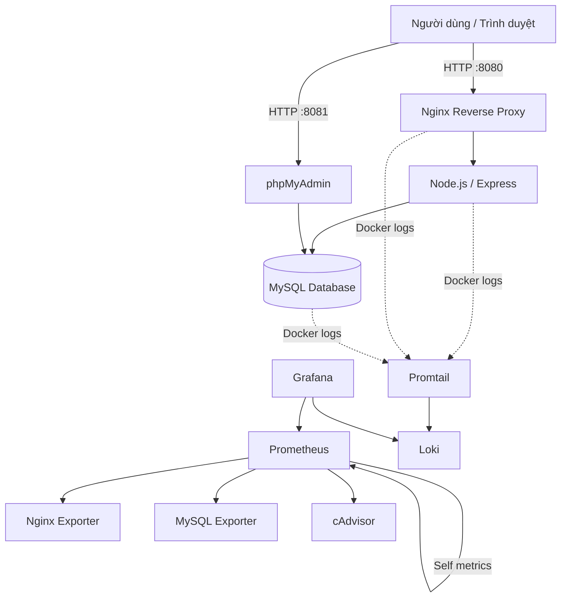

# ĐỀ 35 – HỆ THỐNG QUIZ ONLINE / THI TRẮC NGHIỆM

**Đồ án môn học: Triển khai và Quản trị Hệ thống Phần mềm**

Hệ thống thi trắc nghiệm trực tuyến được phát triển bằng **Node.js, Express, EJS và MySQL**, triển khai qua **Docker Compose**, sử dụng **Nginx Reverse Proxy**, giám sát với **Prometheus + Grafana**, thu thập log tập trung bằng **Loki + Promtail**, kết hợp các biện pháp **Security Hardening**.

## 1. Thông tin đề tài

| Thông tin | Nội dung |
|---|---|
| Đề tài | Đề 35 – Hệ thống Quiz / Thi trắc nghiệm |
| Sinh viên | Lưu Quang Lực |
| Mã sinh viên | DTC245200349 |
| Trường | Đại học Công nghệ Thông tin và Truyền thông Thái Nguyên |
| Khoa | Công nghệ thông tin |
| Học phần | Triển khai và Quản trị Hệ thống Phần mềm |
| Repository | [DTC245200349-quiz-online](https://github.com/dtc245200349-collab/DTC245200349-quiz-online) |

## 2. Giới thiệu hệ thống

Quiz Online là website hỗ trợ tổ chức thi và ôn tập trắc nghiệm trực tuyến.

Hệ thống cho phép quản trị viên quản lý ngân hàng câu hỏi, tạo đề thi, quản lý người dùng và xem kết quả. Sinh viên có thể đăng ký tài khoản, lựa chọn đề thi, làm bài, nộp bài và xem kết quả chấm điểm tự động.

Dữ liệu được quản lý bằng MySQL. Hệ thống còn tích hợp các thành phần triển khai, giám sát, thu thập log và bảo mật theo yêu cầu học phần.

### Chức năng của sinh viên

- Đăng ký, đăng nhập và đăng xuất.
- Xem danh sách đề thi đang được mở.
- Tìm kiếm và xem thông tin đề thi.
- Làm bài trắc nghiệm gồm bốn phương án A, B, C, D.
- Hiển thị thời gian làm bài còn lại.
- Tự động lưu đáp án trong quá trình làm bài.
- Tiếp tục làm bài khi tải lại trang.
- Nộp bài và nhận kết quả chấm điểm tự động.
- Xem lịch sử làm bài, đáp án đúng và phần giải thích.

### Chức năng của quản trị viên

- Xem Dashboard thống kê.
- Quản lý tài khoản sinh viên.
- Khóa hoặc mở khóa tài khoản.
- Thêm, sửa, tìm kiếm và quản lý câu hỏi.
- Tạo và chỉnh sửa đề thi từ ngân hàng câu hỏi.
- Thiết lập thời gian và số lượng câu hỏi.
- Mở đề thi hoặc lưu nháp.
- Xem và lọc kết quả thi.
- Xem chi tiết bài làm của sinh viên.

## 3. Công nghệ sử dụng

| Thành phần | Công nghệ |
|---|---|
| Backend | Node.js 22, Express 5 |
| Frontend | EJS, HTML, CSS, Bootstrap 5, JavaScript |
| Database | MySQL 8.4 |
| Quản lý database | phpMyAdmin 5.2 |
| Container | Docker, Docker Compose |
| Reverse Proxy | Nginx 1.28 |
| Metrics Monitoring | Prometheus 3.15 |
| Dashboard Monitoring | Grafana 13.2 |
| Container Monitoring | cAdvisor |
| Nginx Monitoring | Nginx Prometheus Exporter |
| MySQL Monitoring | MySQL Exporter |
| Centralized Logging | Loki 3.7 |
| Log Collector | Promtail 3.6 |
| Quản lý mã nguồn | Git, GitHub |

Các phiên bản được ghim trong Docker Compose có thể được kiểm tra trực tiếp trong repository.

## 4. Kiến trúc triển khai



### Cơ chế hoạt động

1. Người dùng gửi yêu cầu đến Nginx qua cổng 8080.
2. Nginx chuyển tiếp yêu cầu đến ứng dụng Node.js trong mạng Docker nội bộ.
3. Node.js xử lý nghiệp vụ và truy cập MySQL.
4. phpMyAdmin hỗ trợ quản lý cơ sở dữ liệu.
5. Prometheus thu thập metrics từ các Exporter và cAdvisor.
6. Grafana hiển thị Dashboard giám sát hệ thống.
7. Promtail đọc log Docker và chuyển tới Loki.
8. Grafana truy vấn nhật ký hệ thống từ Loki bằng LogQL.

Hệ thống sử dụng các mạng Docker để phân tách những dịch vụ cần truy cập từ bên ngoài và các dịch vụ nội bộ.

## 5. Danh sách Docker Services

Hệ thống triển khai 11 dịch vụ bằng Docker Compose.

| Dịch vụ | Cổng | Vai trò |
|---|---|---|
| app | 3000 nội bộ | Ứng dụng Quiz Online |
| db | 3306 nội bộ | MySQL |
| nginx | 8080 | Reverse Proxy |
| phpmyadmin | 8081 | Quản lý database |
| prometheus | 9090 | Thu thập metrics |
| grafana | 3001 | Dashboard |
| nginx-exporter | 9113 nội bộ | Metrics Nginx |
| mysql-exporter | 9104 nội bộ | Metrics MySQL |
| cadvisor | 8080 nội bộ | Metrics container |
| loki | 3100 | Lưu trữ log |
| promtail | 9080 nội bộ | Thu thập log |

Các cổng được công bố trên máy host mặc định chỉ bind vào `127.0.0.1`, không tự động mở cho các máy khác trên mạng.

## 6. Yêu cầu môi trường

Môi trường triển khai đã sử dụng:

- Windows 11.
- Docker Desktop với WSL2.
- Docker Compose.
- Visual Studio Code.
- Git.
- Node.js 22 trở lên để chạy các script hỗ trợ.
- Trình duyệt Google Chrome hoặc Microsoft Edge.

Máy triển khai mẫu sử dụng RAM 8 GB và cấu hình giới hạn tài nguyên WSL2. Nếu chạy trên máy cấu hình thấp, cần theo dõi tài nguyên Docker trước khi khởi động đầy đủ các dịch vụ.

## 7. Hướng dẫn cài đặt và triển khai

### 7.1. Clone repository

Mở PowerShell:

```powershell
git clone https://github.com/dtc245200349-collab/DTC245200349-quiz-online.git

cd DTC245200349-quiz-online
```

Nếu đã có mã nguồn trên máy, chỉ cần mở thư mục dự án hiện tại, không cần clone lại.

### 7.2. Cài đặt dependencies và chuẩn bị môi trường

```powershell
npm.cmd ci

npm.cmd run setup:env
```

Script `setup:env` tạo file `.env` cùng các mật khẩu ngẫu nhiên ban đầu nếu file chưa tồn tại.

Nếu `.env` đã tồn tại, script không ghi đè.

Tiếp theo mở:

```powershell
notepad .env
```

Kiểm tra cấu hình cơ sở dữ liệu, session và hai biến bổ sung:

```dotenv
GRAFANA_ADMIN_PASSWORD=
MYSQL_EXPORTER_PASSWORD=
```

Cần tự đặt hai mật khẩu mạnh, riêng biệt, vào bên phải dấu `=` trước khi khởi động Monitoring.

**Không đưa file `.env` hoặc mật khẩu thật lên GitHub.**

### 7.3. Khởi động ứng dụng và database

```powershell
docker compose -f compose.yaml config --quiet
```

Nếu cấu hình hợp lệ:

```powershell
docker compose -f compose.yaml up -d --build
```

Kiểm tra:

```powershell
docker compose -f compose.yaml ps
```

### 7.4. Khởi tạo dữ liệu mẫu

Sau khi MySQL và ứng dụng đã sẵn sàng:

```powershell
docker compose -f compose.yaml exec app npm run db:seed
```

Dữ liệu mẫu gồm:

- 2 tài khoản: quản trị viên và sinh viên.
- 20 câu hỏi.
- 3 đề thi mẫu.

Script không tự thay đổi mật khẩu tài khoản đã tồn tại.

### 7.5. Chuẩn bị tài khoản MySQL Monitoring

Trước khi sử dụng MySQL Exporter, cần tạo tài khoản giám sát `quiz_monitor` và cấp các quyền cần thiết.

Mật khẩu của tài khoản này phải khớp với `MYSQL_EXPORTER_PASSWORD` trong `.env`.

Xem hướng dẫn chi tiết:

[docs/MONITORING.md](docs/MONITORING.md)

Tài khoản giám sát không được sử dụng thay tài khoản quản trị database.

### 7.6. Khởi động toàn bộ hệ thống

Sau khi đã thiết lập các biến môi trường và tài khoản giám sát:

```powershell
docker compose -f compose.yaml -f compose.monitoring.yaml -f compose.logging.yaml config --quiet
```

Khởi động:

```powershell
docker compose -f compose.yaml -f compose.monitoring.yaml -f compose.logging.yaml up -d --build
```

Kiểm tra:

```powershell
docker compose -f compose.yaml -f compose.monitoring.yaml -f compose.logging.yaml ps
```

Các dịch vụ phải ở trạng thái `Up`; dịch vụ có healthcheck cần báo `healthy`.

**Lưu ý:** Cấu hình MySQL, Monitoring và Logging được chia thành ba file Compose để dễ quản lý và kiểm thử.

## 8. Địa chỉ truy cập hệ thống

| Thành phần | Địa chỉ |
|---|---|
| Website Quiz Online | http://localhost:8080 |
| Trang đăng nhập | http://localhost:8080/login |
| phpMyAdmin | http://localhost:8081 |
| Prometheus | http://localhost:9090 |
| Prometheus Targets | http://localhost:9090/targets |
| Grafana | http://localhost:3001 |
| Loki Ready | http://localhost:3100/ready |

Các địa chỉ trên dành cho môi trường triển khai cục bộ.

## 9. Tài khoản demo

Sau khi thiết lập môi trường và seed:

| Vai trò | Email |
|---|---|
| Admin | `admin@quiz.local` |
| Student | `student@quiz.local` |

Mật khẩu website tương ứng được quản lý thông qua:

```dotenv
SEED_ADMIN_PASSWORD=
SEED_STUDENT_PASSWORD=
```

Nếu sử dụng script tạo môi trường, thông tin demo ban đầu còn được lưu tại:

```text
.runtime/demo-accounts.txt
```

Thư mục `.runtime` không được đưa lên GitHub.

**Lưu ý:** Tài khoản phpMyAdmin sử dụng tài khoản MySQL, không sử dụng email đăng nhập của website.

Grafana sử dụng tài khoản mặc định `admin` và mật khẩu trong biến `GRAFANA_ADMIN_PASSWORD`, trừ khi đã thay đổi thông tin đăng nhập sau khi khởi tạo.

## 10. Nginx Reverse Proxy

Nginx tiếp nhận yêu cầu từ trình duyệt và chuyển tới ứng dụng Node.js.

File cấu hình:

```text
deploy/nginx/nginx.conf
```

Các biện pháp bảo mật đã kiểm tra gồm:

- Content-Security-Policy.
- X-Frame-Options.
- X-Content-Type-Options.
- Referrer-Policy.
- Permissions-Policy.

Kiểm tra cấu hình:

```powershell
docker compose -f compose.yaml exec nginx nginx -t
```

Kiểm tra HTTP Headers:

```powershell
curl.exe -I http://localhost:8080/login
```

Nginx còn cung cấp endpoint nội bộ `stub_status` trên cổng 8082 để Nginx Exporter thu thập dữ liệu.

## 11. Monitoring – Prometheus và Grafana

Hệ thống giám sát gồm:

- Prometheus.
- Grafana.
- Nginx Exporter.
- MySQL Exporter.
- cAdvisor.

Cấu hình:

```text
compose.monitoring.yaml
deploy/prometheus/prometheus.yml
deploy/grafana/
```

### Prometheus Targets

Các target đã được kiểm thử thành công:

| Job | Kết quả kiểm thử |
|---|---|
| prometheus | UP |
| nginx | UP |
| mysql | UP |
| cadvisor | UP |

Truy cập:

http://localhost:9090/targets

### Truy vấn PromQL mẫu

Kiểm tra kết nối MySQL:

```promql
mysql_up
```

Số kết nối MySQL:

```promql
mysql_global_status_threads_connected
```

Kết nối Nginx:

```promql
nginx_connections_active
```

Số request Nginx trung bình mỗi giây:

```promql
rate(nginx_http_requests_total[2m])
```

Giám sát RAM container:

```promql
container_memory_usage_bytes
```

Giám sát CPU theo cgroup container:

```promql
sum by (id) (
  rate(container_cpu_usage_seconds_total{
    job="cadvisor",
    id=~"/docker/.+"
  }[2m])
) * 100
```

Truy vấn CPU thể hiện mức sử dụng theo phần trăm một lõi CPU. Một container có thể vượt 100% nếu sử dụng nhiều lõi.

### Grafana Dashboard

Dashboard đã được tạo:

**Quiz Online - System Monitoring**

Gồm sáu panel:

1. Docker Container RAM Usage.
2. Docker Container CPU Usage.
3. Nginx Active Connections.
4. Nginx HTTP Requests per Second.
5. MySQL Active Connections.
6. MySQL Status.

File Dashboard:

```text
deploy/grafana/dashboards/quiz-system-monitoring.json
```

Grafana sử dụng provisioning để tải cấu hình datasource và Dashboard từ repository.

Xem thêm:

[Hướng dẫn Monitoring](docs/MONITORING.md)

## 12. Centralized Logging – Loki và Promtail

Hệ thống sử dụng Loki để lưu trữ và truy vấn nhật ký, Promtail để đọc log Docker.

File cấu hình:

```text
compose.logging.yaml
deploy/loki/loki.yml
deploy/promtail/promtail.yml
```

### LogQL 1 – Xem toàn bộ Docker logs

```logql
{job="docker"}
```

### LogQL 2 – Lọc log Nginx

```logql
{job="docker"} | json | service="nginx"
```

### LogQL 3 – Đếm log trong 5 phút

```logql
sum(count_over_time({job="docker"}[5m]))
```

### Truy vấn bổ sung – Tìm lỗi và cảnh báo

```logql
{job="docker"} |~ "(?i)error|warn|failed"
```

Cả ba truy vấn chính đã được kiểm thử có kết quả trong Grafana Explore.

### Lưu trữ log

Loki sử dụng volume:

```text
loki_data
```

Promtail lưu vị trí đọc log vào:

```text
promtail_positions
```

Các Docker named volumes giúp bảo toàn dữ liệu qua quá trình tạo lại container thông thường, miễn là volume không bị xóa.

**Lưu ý:** Promtail đã hết vòng đời hỗ trợ từ ngày 02/03/2026 và chỉ được giữ lại trong đồ án theo yêu cầu giảng viên. Với hệ thống triển khai mới, nên chuyển sang Grafana Alloy.

Chi tiết:

[Logging và Hardening](docs/LOGGING-HARDENING.md)

## 13. Security Hardening

Các biện pháp bảo mật đã áp dụng và kiểm tra:

| Biện pháp | Mô tả |
|---|---|
| Network Isolation | Phân tách frontend, backend và mạng quản trị |
| Non-root | Ứng dụng Node.js và Loki chạy bằng người dùng không phải root |
| no-new-privileges | Hạn chế tiến trình nâng quyền |
| Security Headers | Cấu hình header bảo mật qua Nginx |
| MySQL Least Privilege | Tài khoản giám sát chỉ có quyền cần thiết |
| Environment Secrets | Không commit `.env` |
| Restricted Ports | Chỉ công bố các cổng cần thiết trên localhost |
| Read-only Filesystem | Ứng dụng Node.js sử dụng filesystem chỉ đọc |

### Phân quyền MySQL Exporter

Tài khoản `quiz_monitor` được kiểm tra với các quyền:

```sql
GRANT PROCESS, REPLICATION CLIENT ON *.*
TO 'quiz_monitor'@'%';

GRANT SELECT ON performance_schema.*
TO 'quiz_monitor'@'%';

GRANT SELECT ON sys.*
TO 'quiz_monitor'@'%';
```

Đây là các quyền phục vụ giám sát; không cấp quyền sửa dữ liệu ứng dụng.

### Giới hạn của hệ thống

Đây là môi trường thực hành cục bộ, không phải cấu hình production hoàn chỉnh.

- Loki đang tắt xác thực.
- Chưa cấu hình HTTPS với chứng chỉ tin cậy.
- Promtail đã hết hỗ trợ.
- Chưa có cơ chế khôi phục thảm họa được kiểm chứng đầy đủ.

Không nên công khai các endpoint quản trị, Monitoring hoặc Logging ra Internet nếu chưa triển khai thêm bảo vệ phù hợp.

## 14. Kiểm thử hệ thống

### Kiểm thử mã nguồn

```powershell
npm.cmd test
npm.cmd run check
```

### Kiểm tra Docker Compose

```powershell
docker compose -f compose.yaml -f compose.monitoring.yaml -f compose.logging.yaml config --quiet
```

### Kiểm tra triển khai ứng dụng

```powershell
npm.cmd run check:compose
npm.cmd run test:deployment
```

Lệnh `test:deployment` thực hiện kiểm thử tích hợp và có thể tạo thêm dữ liệu QA để lưu bằng chứng. Chỉ chạy khi hệ thống và Chrome đã sẵn sàng.

### Kiểm tra các endpoint

```powershell
curl.exe -I http://localhost:8080/login
curl.exe -I http://localhost:8081
curl.exe http://localhost:9090/-/ready
curl.exe http://localhost:3001/api/health
curl.exe http://localhost:3100/ready
```

Trong đợt kiểm thử tổng thể, website, phpMyAdmin, Prometheus, Grafana và Loki đã trả HTTP 200.

Các target Prometheus `cadvisor`, `mysql`, `nginx` và `prometheus` cũng đã báo UP.

### Kiểm tra secrets

```powershell
node scripts/check-secrets.js
```

Script hỗ trợ kiểm tra các đường dẫn nhạy cảm và một số dạng secrets, nhưng không thay thế công cụ quét secrets chuyên dụng.

## 15. Cấu trúc thư mục dự án

```text
DTC245200349-quiz-online/
|
|-- database/
|   |-- schema.sql
|   `-- sample-data.js
|
|-- deploy/
|   |-- nginx/
|   |-- mysql/
|   |-- phpmyadmin/
|   |-- prometheus/
|   |-- grafana/
|   |   |-- dashboards/
|   |   `-- provisioning/
|   |-- loki/
|   `-- promtail/
|
|-- src/
|   |-- routes/
|   |-- middleware/
|   |-- services/
|   |-- views/
|   |-- lib/
|   |-- app.js
|   `-- server.js
|
|-- public/
|   |-- css/
|   `-- js/
|
|-- scripts/
|-- tests/
|-- docs/
|-- reports/
|
|-- Dockerfile
|-- compose.yaml
|-- compose.monitoring.yaml
|-- compose.logging.yaml
|-- docker-compose.yml
|-- .env.example
|-- package.json
|-- package-lock.json
`-- README.md
```

## 16. Quản lý mã nguồn bằng GitHub

Repository:

https://github.com/dtc245200349-collab/DTC245200349-quiz-online

Ba commit triển khai chính:

| Commit | Nội dung |
|---|---|
| `5320527` | Deploy Quiz App, MySQL và Nginx Reverse Proxy |
| `9f518e0` | Tích hợp Prometheus, Grafana và Exporters |
| `a910c0c` | Tích hợp Loki, Promtail, LogQL và Hardening |

Các mốc này tương ứng với ba giai đoạn triển khai theo yêu cầu học phần.

Các commit tài liệu bổ sung sau đó không làm mất lịch sử ba mốc triển khai.

## 17. Hướng dẫn vận hành

### Kiểm tra container

```powershell
docker compose -f compose.yaml -f compose.monitoring.yaml -f compose.logging.yaml ps
```

### Xem log ứng dụng

```powershell
docker compose -f compose.yaml logs --tail=50 app
```

### Dừng các dịch vụ

```powershell
docker compose -f compose.yaml -f compose.monitoring.yaml -f compose.logging.yaml stop
```

### Khởi động lại các dịch vụ

```powershell
docker compose -f compose.yaml -f compose.monitoring.yaml -f compose.logging.yaml start
```

### Kiểm tra CPU và RAM

```powershell
docker stats --no-stream
```

### Kiểm tra dung lượng Docker

```powershell
docker system df
```

**Cảnh báo quan trọng:** Không sử dụng `docker compose down -v` khi muốn giữ dữ liệu MySQL, lịch sử thi, cấu hình Grafana và nhật ký Loki.

## 18. Một số lỗi thường gặp

| Lỗi | Hướng xử lý |
|---|---|
| Docker không được nhận diện | Mở Docker Desktop và kiểm tra Docker Engine |
| `no such service` | Kiểm tra tên service và các file `-f` |
| MySQL unhealthy | Xem healthcheck và log container |
| Không đăng nhập được Quiz Online | Kiểm tra seed và tài khoản trong `.env` |
| `mysql_up = 0` | Kiểm tra tài khoản `quiz_monitor`, mật khẩu và quyền |
| Prometheus No data | Kiểm tra Targets và tên metric |
| Grafana không có Dashboard | Kiểm tra các file provisioning và Dashboard JSON |
| Loki trả 503 lúc mới khởi động | Kiểm tra lại `/ready` và log Loki |
| LogQL No data | Kiểm tra Promtail, Loki, đường dẫn log và khoảng thời gian |
| Cổng đã được sử dụng | Kiểm tra container hoặc tiến trình chiếm cổng |

## 19. Tài liệu liên quan

- [Kiến trúc hệ thống](docs/ARCHITECTURE.md)
- [Hướng dẫn Docker giai đoạn 1](docs/DOCKER-STAGE1.md)
- [Hướng dẫn Monitoring](docs/MONITORING.md)
- [Logging và Hardening](docs/LOGGING-HARDENING.md)
- [Hướng dẫn Backup và Restore](docs/BACKUP-RESTORE.md)
- [Kịch bản demo](docs/DEMO.md)
- [Báo cáo kiểm thử](docs/TEST-REPORT.md)
- [Kế hoạch các giai đoạn](docs/IMPLEMENTATION-PLAN.md)
- [Danh sách file dự án](docs/FILES.md)

Một số tài liệu giai đoạn 1 phản ánh trạng thái tại thời điểm ban đầu và được giữ lại để theo dõi quá trình phát triển. README hiện tại mô tả cấu hình tích hợp sau ba commit triển khai.

## 20. Kết luận

Dự án đã triển khai hệ thống Quiz Online với các thành phần chính:

- Website thi trắc nghiệm và chấm điểm tự động.
- Database MySQL và công cụ phpMyAdmin.
- Nginx Reverse Proxy.
- Monitoring bằng Prometheus và Grafana.
- Giám sát tài nguyên container bằng cAdvisor.
- Thu thập log tập trung bằng Loki và Promtail.
- Truy vấn LogQL.
- Các biện pháp Hardening cơ bản.
- Quản lý mã nguồn và cấu hình bằng GitHub.

Kết quả kiểm thử đã xác nhận các chức năng và thành phần triển khai chính hoạt động trong môi trường Docker Desktop trên Windows.

Dự án phục vụ mục đích học tập, thực hành triển khai và quản trị hệ thống phần mềm. Khi đưa vào môi trường thực tế cần bổ sung các biện pháp bảo mật, sao lưu, xác thực và vận hành production phù hợp.

---

**Sinh viên thực hiện:** Lưu Quang Lực – DTC245200349

**Trường Đại học Công nghệ Thông tin và Truyền thông Thái Nguyên**