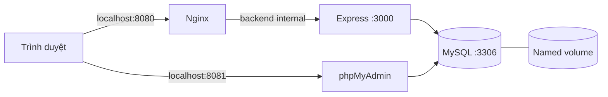

# Đề 35 — Quiz Online — DTC245200349

Đồ án cuối học phần **Triển khai và Quản trị Hệ thống Phần mềm**. Ứng dụng động sử dụng Node.js, Express, MySQL (`mysql2`), EJS, Bootstrap 5, `express-session` và `bcrypt`. Mọi bài làm và kết quả được lưu trong MySQL; không dùng dữ liệu giả hoặc localStorage thay backend.

Repository dự kiến: **DTC245200349-quiz-online**. Giai đoạn 1 bổ sung Nginx và phpMyAdmin. Prometheus/Grafana thuộc giai đoạn 2; Loki/Promtail/LogQL và báo cáo hoàn chỉnh thuộc giai đoạn 3. Xem [kế hoạch ba mốc commit](docs/IMPLEMENTATION-PLAN.md).

**Trạng thái đợt 24/10/2026:** mã nguồn và cấu hình giai đoạn 1 đã được chuẩn bị; kiểm thử Docker runtime còn bị chặn do máy chưa có Docker Engine/WSL. Chưa commit hoặc push. Kết quả cũ ngày 09/10 chỉ phản ánh ứng dụng chạy local, không phải bằng chứng Docker. Xem [báo cáo hiện tại](docs/STAGE1-TEST-REPORT.md).



Docker là phương án triển khai được chấm điểm. Cách chạy local bên dưới dùng để phát triển và kiểm thử khi Docker chưa sẵn sàng.

## Chạy ngay trên máy Windows hiện tại

Trong thư mục `D:\Hệ thống thi trắc nghiệm`, dùng terminal PowerShell. Dùng `npm.cmd` để không vướng chính sách chặn `npm.ps1`.

```powershell
npm.cmd ci
node scripts/setup-env.js --local-mysql
node scripts/local-mysql.js
npm.cmd run db:init
npm.cmd run db:seed
npm.cmd start
```

- Yêu cầu Node.js **22 trở lên**, MySQL Server **8.0 trở lên**. Helper mặc định tìm `C:\Program Files\MySQL\MySQL Server 8.0\bin\mysqld.exe`; nếu khác, đặt `$env:MYSQLD_PATH = 'đường dẫn đến mysqld.exe'` trước khi chạy.
- `.env` và tài khoản demo đã được tạo trong lần thiết lập dự án. `setup-env` sẽ **không ghi đè** `.env` đã có. Helper chỉ chấp nhận `DB_HOST=127.0.0.1`, `DB_PORT=3317` để tránh dịch vụ MySQL hiện có.
- Helper tạo một phiên MySQL riêng chạy nền ở **3317**, lưu dữ liệu tại `.runtime/mysql/data`. Với đường dẫn tiếng Việt, helper tạo junction tên ASCII trong thư mục tạm, trỏ về đúng dữ liệu dự án; không di chuyển hay xóa dữ liệu.
- Sau khi khởi động lại máy, chạy lại `node scripts/local-mysql.js`, rồi `npm.cmd start`. Không cần seed lại mỗi lần.
- Nếu app đã chạy, không mở thêm một tiến trình cùng cổng; dùng cửa sổ terminal đang chạy để dừng bằng `Ctrl+C` trước khi khởi động lại.

Mở **http://localhost:3000**. Kiểm tra database tại **http://localhost:3000/health**, kết quả mong đợi:

```json
{ "status": "ok", "database": "connected" }
```

Tài khoản demo và mật khẩu ngẫu nhiên nằm trong **[.runtime/demo-accounts.txt](.runtime/demo-accounts.txt)** sau khi chạy `setup-env`:

| Vai trò | Email mặc định | Trang sau đăng nhập |
|---|---|---|
| Quản trị viên | `admin@quiz.local` | `/admin` |
| Sinh viên | `student@quiz.local` | `/exams` |

Mật khẩu lấy từ `SEED_ADMIN_PASSWORD`, `SEED_STUDENT_PASSWORD` trong `.env`; không được hardcode vào mã nguồn. Nếu bạn thay email/mật khẩu trước seed, dùng các giá trị trong `.env`. Seed không thay mật khẩu tài khoản đã tồn tại. Sinh viên cũng có thể tự đăng ký tại `/register`.

## Chạy bằng Docker Compose

Cài Docker Desktop, WSL2 và bật Linux containers. Dùng Compose 2.20.3+; hướng dẫn chi tiết tại [docs/DOCKER-STAGE1.md](docs/DOCKER-STAGE1.md).

```powershell
npm.cmd run setup:env
docker version
docker compose -f compose.yaml config --quiet
docker compose -f compose.yaml up -d --build --wait --wait-timeout 240
docker compose -f compose.yaml exec app node scripts/seed.js
docker compose -f compose.yaml ps
```

Đợi các service healthy trước khi seed. Mở **http://localhost:8080** để sử dụng website qua Nginx và **http://localhost:8081** để vào phpMyAdmin. phpMyAdmin dùng DB_USER/DB_PASSWORD trong `.env`, không dùng tài khoản website; không cho đăng nhập root hoặc tự động đăng nhập bằng mật khẩu lưu trong cấu hình.

Compose đặt DB nội bộ ở `db:3306`, Express ở `app:3000`. Hai cổng này không public. Mặc định chỉ bind Nginx 8080 và phpMyAdmin 8081 trên `127.0.0.1`; đổi NGINX_PORT/PHPMYADMIN_PORT nếu bị chiếm. PORT trong `.env` chỉ dành cho cách chạy Node local, không đổi cổng Nginx.

Project Compose có tên `dtc245200349-quiz-online`. Volume dữ liệu riêng được giữ qua restart; không tự động kết nối hoặc di chuyển database Windows hiện có. MySQL chỉ khởi tạo schema trên volume trống, sau đó cấp DML cho user ứng dụng. Container app không nhận root password và không chạy DDL; chạy non-root, filesystem chỉ đọc, bỏ Linux capabilities, có healthcheck. **Seed chạy bằng lệnh riêng** và không thay mật khẩu tài khoản đã tồn tại.

```powershell
docker compose -f compose.yaml logs -f app
docker compose -f compose.yaml stop
docker compose -f compose.yaml start
```

`docker compose stop` giữ dữ liệu. Không dùng `docker compose down -v` nếu cần giữ bài làm; lệnh đó xóa volume. Sau khi volume đã khởi tạo, thay mật khẩu trong `.env` **không tự thay mật khẩu MySQL**; cần quy trình đổi mật khẩu qua tài khoản được cấp quyền.

`docker-compose.yml` được giữ như file tương thích có `include: compose.yaml`, tránh hai cấu hình triển khai khác nhau. Không in hoặc chia sẻ `docker compose config` đầy đủ vì chứa secrets; dùng `config --quiet`.

Nghiệm thu thật sau khi stack khởi chạy và seed:

```powershell
npm.cmd run check:compose
npm.cmd run test:deployment
node scripts/check-secrets.js
```

Test deployment tạo bản ghi QA riêng rồi giữ lại, kiểm tra Nginx, header, non-root, cổng riêng, đăng nhập admin, tạo đề, sinh viên thi/chấm điểm, truy vấn MySQL và phpMyAdmin. Nếu Docker chưa sẵn sàng, ghi BLOCKED. Bằng chứng lưu tại `reports/evidence`; [checklist ảnh](reports/screenshots/README.md).

## Kết nối một MySQL do bạn tự quản lý

1. Chạy `npm.cmd ci` và `npm.cmd run setup:env`.
2. Cấp một database mới riêng và tài khoản riêng; đặt `DB_HOST`, `DB_PORT`, `DB_NAME`, `DB_USER`, `DB_PASSWORD` trong `.env`.
3. Tài khoản cần quyền tạo bảng và thao tác dữ liệu trong database đó. `db:init` chỉ tạo database khi chưa có và khi tài khoản đủ quyền. Không trỏ vào database đang dùng cho hệ thống khác.
4. Chạy `npm.cmd run db:init`, `npm.cmd run db:seed`, `npm.cmd start`.

File [database/schema.sql](database/schema.sql) chứa DDL có PK, FK, index và CHECK. Script khởi tạo dùng `CREATE TABLE IF NOT EXISTS`; không DROP/TRUNCATE. Đây là khởi tạo schema mới, không phải công cụ tự sửa cấu trúc database khác đã tồn tại.

## Chức năng

**Sinh viên:** đăng ký, đăng nhập, xem/tìm đề mở, xem thời gian và số câu, làm bài 4 phương án, đồng hồ đếm ngược, tự lưu đáp án, tiếp tục sau tải lại trang, nộp/chấm điểm trên server, xem lịch sử và đáp án kèm giải thích.

**Quản trị:** dashboard người dùng/đề thi/bài làm/điểm trung bình và phân bố điểm; tìm và sửa thông tin sinh viên, khóa/mở tài khoản; thêm/sửa/xóa/tìm câu hỏi; tạo/sửa đề từ ngân hàng, chọn số câu và thời gian, mở đề hoặc lưu nháp; lưu trữ đề; lọc kết quả theo đề/sinh viên và xem chi tiết bài làm.

**Quy tắc:** cho phép nhiều lượt ôn tập, mỗi lượt lưu riêng. Mốc đạt trong thống kê là 5/10. Mọi câu có trọng số bằng nhau. Lượt thi đang làm giữ bản chụp đề gốc. Lưu trữ mềm đề và câu hỏi bảo toàn lịch sử. Câu đang thuộc đề chưa lưu trữ không được xóa. Không xóa vật lý sinh viên có lịch sử; dùng khóa tài khoản.

Giao diện tiếng Việt, xanh dương/trắng, sidebar quản trị, bảng và form responsive. CSS/JS Bootstrap được phục vụ từ package cục bộ.

## Kiểm thử

```powershell
npm.cmd test
npm.cmd run check
```

Các lệnh trên kiểm tra chấm điểm, validation, EJS, escape XSS và cú pháp JavaScript, không cần MySQL. Kiểm thử tích hợp và Chrome tạo **database mới ngẫu nhiên**, không sử dụng hay xóa dữ liệu của database ứng dụng.

Với MySQL riêng ở cổng 3317:

```powershell
node scripts/run-integration.js
node scripts/run-integration.js --browser
```

Với MySQL khác, đặt thông tin tài khoản có quyền tạo database kiểm thử rồi chạy:

```powershell
$env:TEST_DB_USER = 'tai_khoan_kiem_thu'
$env:TEST_DB_PASSWORD = 'mat_khau_cua_ban'
npm.cmd run test:integration
npm.cmd run test:browser
```

Browser QA cần Google Chrome (mặc định) hoặc đặt `$env:BROWSER_CHANNEL = 'msedge'` nếu có Microsoft Edge. Test kiểm tra tự lưu, tải lại, nộp, điểm 10/10, admin tạo đề, giao diện 390px và lỗi JS/CSP. Ảnh nằm trong `.runtime/screenshots`. Database `quiz_test_*` / `quiz_browser_*` được giữ lại để đối chiếu, không tự xóa.

Xem [docs/TEST-REPORT.md](docs/TEST-REPORT.md) để biết kết quả kiểm thử thực tế và giới hạn môi trường.

File trên là đợt kiểm thử 09/10/2026. Đợt nâng cấp Đề 35 có báo cáo riêng: [docs/STAGE1-TEST-REPORT.md](docs/STAGE1-TEST-REPORT.md).

## Cấu trúc chính

```text
database/          schema.sql và nội dung 20 câu hỏi mẫu
src/
  app.js           middleware, session, view engine, error handler
  server.js        HTTP server và worker chấm bài hết giờ
  config.js, db.js cấu hình và transaction
  session-store.js session lưu MySQL
  middleware/      CSRF, xác thực, phân quyền
  lib/             kiểm tra input và tính điểm
  routes/          auth, student, admin
  services/        nghiệp vụ lượt thi và chấm điểm
  views/           EJS tiếng Việt
public/            CSS, JavaScript, favicon
scripts/           khởi tạo, seed, kiểm tra, helper MySQL, browser QA
tests/             unit, EJS và kiểm thử tích hợp
docs/              kiến trúc, demo, báo cáo kiểm thử
deploy/            Nginx, khởi tạo quyền MySQL, phpMyAdmin
reports/           khung báo cáo, checklist ảnh và bằng chứng runtime
Dockerfile
compose.yaml
docker-compose.yml
.env.example
```

## Vận hành và cấu hình

- `.env`, `.runtime`, `node_modules` không vào Git hoặc Docker build context. Giữ bí mật file tài khoản demo; đổi mật khẩu và bỏ tài khoản demo khi dùng thật.
- `SESSION_SECRET` tối thiểu 32 ký tự; script sinh ngẫu nhiên. Session tồn tại 8 giờ và lưu MySQL, không mất chỉ vì restart Node.
- `COOKIE_SECURE=false` phù hợp localhost HTTP. Khi đưa lên HTTPS, đặt `COOKIE_SECURE=true`; chỉ đặt `TRUST_PROXY=1` nếu có đúng một reverse proxy tin cậy, chặn truy cập trực tiếp backend.
- Backup bằng `node scripts/backup-db.js`, restore thử vào database mới theo [docs/BACKUP-RESTORE.md](docs/BACKUP-RESTORE.md). Quy trình Docker backup/restore chưa được kiểm chứng khi thiếu Engine; không chép trực tiếp datadir đang ghi hoặc tự ghi đè dữ liệu.
- Worker kiểm tra bài hết giờ mỗi 15 giây; nếu app ngừng, xử lý bù khi khởi động lại. Đồng hồ giao diện không có quyền sửa deadline.
- Server trả lỗi tiếng Việt, không gửi SQL, mật khẩu hay stack trace ra trình duyệt.
- Giới hạn đăng nhập/đăng ký nằm trong bộ nhớ một tiến trình; triển khai nhiều instance cần kho rate limit dùng chung. Bản đồ án không triển khai gửi email, đặt lại mật khẩu, chống gian lận bằng webcam hoặc lịch thi theo học kỳ vì nằm ngoài phạm vi yêu cầu.

## Xử lý lỗi thường gặp

| Hiện tượng | Cách xử lý |
|---|---|
| PowerShell báo không chạy được npm.ps1 | Dùng `npm.cmd`, không cần đổi ExecutionPolicy |
| `ECONNREFUSED` | Bật MySQL, đối chiếu host/port `.env`; helper riêng dùng 3317 |
| `ER_ACCESS_DENIED_ERROR` | Đối chiếu DB_USER/DB_PASSWORD và quyền database |
| Thiếu bảng `users`/`sessions` | Chạy `npm.cmd run db:init` đúng database |
| `EADDRINUSE` | Cổng HTTP đang được dùng; dừng đúng app cũ hoặc đổi PORT |
| Login xong lại về login trên localhost | Đặt `COOKIE_SECURE=false` khi dùng HTTP |
| Docker không được nhận diện | Cài/bật Docker Desktop; có thể dùng cách MySQL riêng trước |
| MySQL không chấp nhận đường dẫn có dấu | Dùng helper `local-mysql.js` với junction ASCII hoặc Docker |
| Test báo `spawn EPERM` trong môi trường hạn chế | Chạy terminal với quyền tạo tiến trình con; không phải lỗi nghiệp vụ |

Xem [kiến trúc và bảo mật](docs/ARCHITECTURE.md), [kịch bản demo](docs/DEMO.md).

Danh sách file nguồn/cấu hình/tài liệu: [docs/FILES.md](docs/FILES.md).

## GitHub và các mốc chưa thực hiện

Git đã khởi tạo tại chỗ, nhánh dự kiến `main`; chưa commit, chưa gắn remote. Tên repo đề xuất `DTC245200349-quiz-online`. Trước mỗi commit: kiểm tra `git status`, chạy `node scripts/check-secrets.js`, kiểm tra bằng chứng, rồi xin phép người dùng. Ba commit phải phản ánh ba giai đoạn thực hiện thật theo [kế hoạch](docs/IMPLEMENTATION-PLAN.md), không tạo sẵn lịch sử giả.

Prometheus, Grafana, Loki và Promtail chưa được triển khai ở mốc 1. Lệnh kiểm chứng targets/datasource/LogQL và dashboard provisioning sẽ được thêm ở mốc tương ứng sau khi có hệ thống thật. Khung [báo cáo cuối kỳ](reports/README.md) liệt kê nội dung cần hoàn thiện, chưa phải báo cáo 10 trang đã hoàn tất.
