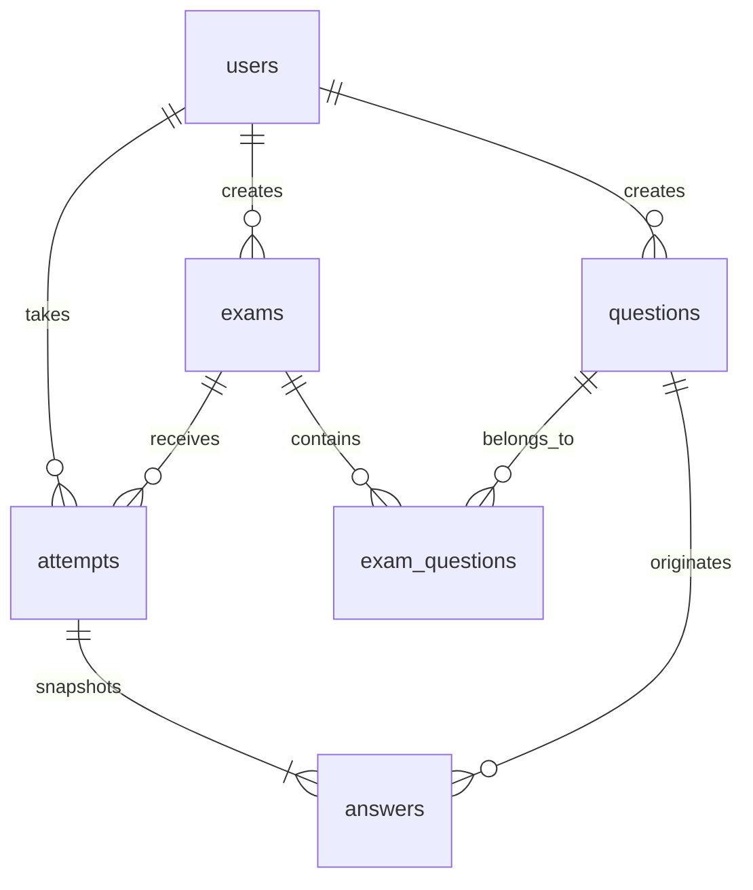

# Kiến trúc và nghiệp vụ

## Luồng xử lý

Trình duyệt → Express router → middleware xác thực/phân quyền/CSRF → validation → service/transaction → mysql2 → MySQL. EJS render HTML từ dữ liệu thực; Bootstrap và JavaScript được phục vụ cục bộ, không cần CDN.

`users` giữ mật khẩu đã băm và vai trò. `exam_questions` là bảng nối với thứ tự câu hỏi. `attempts` lưu thời điểm bắt đầu, hạn cuối, trạng thái, điểm và bản chụp tên đề. `answers` lưu toàn bộ nội dung, phương án, đáp án đúng và giải thích tại thời điểm bắt đầu; chỉnh sửa đề không ảnh hưởng lịch sử. `sessions` là bảng kỹ thuật bổ sung cho express-session.

## Quy tắc thi

- Mỗi câu có một đáp án đúng; câu bỏ trống tính sai. Điểm = số câu đúng / tổng số câu × 10, làm tròn 2 chữ số.
- Thời gian lấy từ `UTC_TIMESTAMP(3)` của MySQL. Giao diện hiển thị giờ Việt Nam. Client không được quyết định điểm hoặc tăng thời gian.
- Một sinh viên chỉ có một lượt đang làm cho cùng đề. Bắt đầu đồng thời được khóa theo user và bảo vệ bằng unique key có generated column.
- Save/submit/expiry khóa hàng `attempts` bằng `FOR UPDATE`. Nộp lại bài đã kết thúc trả về kết quả cũ.
- Khi hết giờ, chỉ đáp án lưu trước hạn được tính. Worker kiểm tra mỗi 15 giây; mở lại bài cũng kích hoạt kiểm tra. Sau khi server ngừng hoạt động, bài hết giờ được xử lý ngay khi khởi động lại.
- Hệ thống cho phép làm lại đề để ôn tập; từng lượt lưu riêng. Đáp án được hiển thị sau khi kết thúc theo yêu cầu đề tài. Vì vậy đây không phải chế độ thi kín một lần với đáp án giữ bí mật đến cuối đợt.
- Xóa đề là lưu trữ mềm: không tạo lượt thi mới, nhưng lượt đang làm và kết quả cũ tiếp tục hợp lệ. Xóa câu hỏi được chặn khi câu vẫn thuộc đề chưa lưu trữ.
- Khóa sinh viên có hiệu lực ở lần request kế tiếp. Không xóa sinh viên có lịch sử nhằm bảo toàn tham chiếu.

## Ranh giới bảo mật

- Mật khẩu bcrypt cost 12; đăng ký luôn tạo `student`, không nhận role do client gửi.
- Regenerate session sau đăng nhập, destroy khi đăng xuất. Session lưu MySQL; cookie HttpOnly, SameSite=Lax, tùy chọn Secure cho HTTPS.
- Token CSRF cho mọi POST, gồm tự lưu; rate limit đăng nhập/đăng ký 30 lần/15 phút/IP. Bộ đếm rate limit nằm trong bộ nhớ, phù hợp triển khai một instance cho demo.
- Kiểm tra quyền sở hữu ở mọi route bài thi; quản trị chỉ xem bài đã kết thúc.
- Các query dữ liệu dùng `execute` với placeholder hoặc `query` với mảng tham số (LIMIT/OFFSET và câu lệnh quản trị khởi tạo). Tên database chỉ cho phép chữ, số và `_` trước khi đưa vào DDL.
- EJS `<%=` escape nội dung người dùng. Helmet đặt CSP, chống nhúng iframe và các header bảo vệ. Mã JavaScript/CSS không phụ thuộc CDN.
- Form sinh viên không chứa `correct_option` hay giải thích trước khi nộp. Chấm điểm đọc snapshot từ MySQL.

## API và trang chính

| Nhóm | Route | Quyền |
|---|---|---|
| Tài khoản | GET/POST `/register`, `/login`; POST `/logout` | Khách / đã đăng nhập |
| Đề thi | GET `/exams`, `/exams/:id`; POST `/exams/:id/start` | Student |
| Làm bài | GET `/attempts/:id`; POST `/attempts/:id/save`, `/attempts/:id/submit` | Chủ bài làm |
| Kết quả | GET `/attempts/:id/result`, `/history` | Chủ bài làm |
| Dashboard | GET `/admin` | Admin |
| Sinh viên | GET `/admin/students`; POST `/admin/students/:id/update` | Admin |
| Câu hỏi | GET `/admin/questions`, `/new`, `/:id/edit`; POST `/new`, `/:id/edit`, `/:id/delete` | Admin |
| Đề thi quản trị | GET `/admin/exams`, `/new`, `/:id/edit`; POST `/new`, `/:id/edit`, `/:id/delete` | Admin |
| Báo cáo | GET `/admin/results`, `/admin/results/:id` | Admin |
| Sức khỏe | GET `/health` | Công khai, chỉ báo trạng thái kết nối |

## Tài liệu tham chiếu

- [Express session: cookie, lưu phiên và cấu hình proxy](https://expressjs.com/en/resources/middleware/session/)
- [mysql2: truy vấn tham số](https://sidorares.github.io/node-mysql2/docs/examples/queries/prepared-statements/select)
